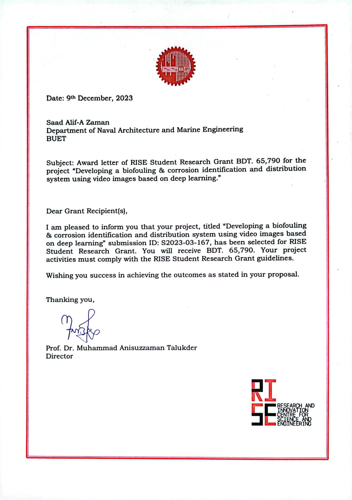



[**Download CV (PDF)**](/files/Saad_Alif_A_Zaman_CV.pdf)

Education
======
* B.Sc. in Naval Architecture and Marine Engineering ([NAME](https://name.buet.ac.bd/)) (April 2019 – July 2024)  
  Bangladesh University of Engineering and Technology ([BUET](https://www.buet.ac.bd/web/#/))
  * Cumulative GPA: 3.37/4.00
<h3>Academic Foundation: Computation & Structural Health</h3>

Selected coursework directly relevant to my research. For full course descriptions, see 
<a href="https://name.buet.ac.bd/undergraduate-courses" target="_blank">NAME's official undergraduate course catalog</a>:
  

**Computation & Mathematics:** Computer Programming I & II (C/C++, FORTRAN, OOP) [A+]; Statistics, PDEs, and Matrices (Applied Probability & Linear Algebra) [A]; Numerical Computations [B]  
**Structural Health & Degradation:** Marine Maintenance and Repair (Corrosion, Fatigue, Biofouling & Defect Analysis) [A-]; Welding Technology (NDT & Defect Inspection) [B+]; Finite Element Method for Ship Structure [B+]  
**Mechanics & Materials:** Mechanics of Structure [A]; Shipbuilding Materials [B+]

  
(click for detailed course descriptions)

  
<em>My coursework provided the physical engineering foundation necessary for applied structural health monitoring. While my research focuses on computer vision, my academic background ensures I understand the physical properties and failure modes of the structures my models inspect.</em>

  
<strong>Computation & Mathematics</strong>

  
<strong>Computer Programming in Ship Design I & II (NAME 336, 436) [Grade: A+]:</strong> Focused on C/C++ and FORTRAN fundamentals, object-oriented programming (OOP), pointers, dynamic memory allocation, arrays, and algorithmic problem-solving for complex engineering computations.

  
<strong>Statistics, Partial Differential Equation and Matrices (Math 283) [Grade: A]:</strong> Foundation in probability theory, continuous and discontinuous distributions, hypothesis testing, regression analysis, and matrix algebra (including eigenvalues and eigenvectors).

  
<strong>Numerical Computations (NAME 416) [Grade: B]:</strong> Covered methods for interpolation, regression analysis, least squares curve fitting, and solving equations using finite difference techniques.

  
<strong>Structural Health & Degradation</strong>

  
<strong>Marine Maintenance and Repair (NAME 415) [Grade: A-]:</strong> Core focus on the physical causes of structural failure, specifically corrosion, fatigue, and deformation. Covered the identification of defects in plates and welds, classification survey requirements, and the prevention/removal of marine biofouling.

  
<strong>Welding Technology (NAME 345) [Grade: B+]:</strong> Study of structural joint integrity, including common welding defects, distortion monitoring, and Non-Destructive Testing (NDT) methodologies for inspecting welded specimens.

  
<strong>Finite Element Method for Ship Structure (NAME 371) [Grade: B+]:</strong> Basic concepts of FEM applied to structural analysis, including the formulation of stiffness matrices for beam and shell elements, and linear static analysis of structures.

  
<strong>Mechanics & Materials</strong>

  
<strong>Mechanics of Structure (NAME 251) [Grade: A]:</strong> Fundamental stress analysis, mechanical properties of materials, normal/shear/combined stresses, theories of failure, and structural joint analysis.

  
<strong>Shipbuilding Materials (MME 293) [Grade: B+]:</strong> Industrially significant properties of metallic materials, protective coatings, and ferrous alloys (plain carbon, alloy, tool, and stainless steels).

Research Experience
======
* **Independent Research Project** (August 2025–Present)
  * "[Interaction-Effect Metric for Data-Scarce Industrial Vision: Application to Ship Hull Biofouling Inspection](https://saadalifazaman.github.io/portfolio/01-research-assistant-biofouling-IE-metric/)"
  * Supervisors: Dr. Kazi Naimul Hoque, Associate Professor, Dept. of Naval Architecture and Marine Engineering, BUET  
	           Samiul Based Shuvo, Assistant Professor, Dept. of Biomedical Engineering, BUET
  * **Engineered** a leakage-free cross-validation protocol (k-n Fold ACV) to reduce test-train data split bias, alongside an Interaction Effect Metric to optimize augmentation pipelines for instance segmentation architectures (YOLOv8/11, Mask R-CNN).
  * **Validated** the framework on a newly curated field dataset ([NDBD](https://saadalifazaman.github.io/portfolio/03-dataset-collection-narayanganj/), n=35), overcoming the extreme visual data scarcity of noisy operational environments to extract reliable physical measurements from limited imagery.
  * **Achieved** a 47% mAP improvement over baseline training, executing cross-model validation and making the full [codebase](https://github.com/saadalifazaman/NDBD/blob/main/5-1%20Fold%20ACV%20for%20YOLOv8m-seg.ipynb) and [dataset](https://github.com/saadalifazaman/NDBD/tree/main) publicly available to ensure reproducibility.
    
* **Undergraduate Thesis**, BUET Final Grade: A+ (4.00/4.00) (June 2023–July 2024)
  * "[Developing a biofouling & corrosion identification and distribution system using video images based on deep learning](https://saadalifazaman.github.io/portfolio/02-undergraduate-thesis-biofouling-detection/)"
  * Supervisor: Dr. Kazi Naimul Hoque, Associate Professor, Dept. of Naval Architecture and Marine Engineering, BUET
  * **Collected and curated** in-situ field data to build the Narayanganj Dockyard Biofouling Dataset ([NDBD](https://saadalifazaman.github.io/portfolio/03-dataset-collection-narayanganj/)) directly from Dockyard & Engineering Works Ltd., Narayanganj (publicly available on GitHub), supplementing it with public bridge inspection data for steel corrosion severity.
  * **Deployed** instance segmentation pipelines on heterogeneous, real-world structural data, demonstrating high-fidelity feature extraction that can be generalized to broader civil infrastructure monitoring, environmental material degradation, and automated condition assessment.
  * **Developed** a video-based detection prototype, establishing the foundational perception pipeline required to integrate robust vision models with autonomous platforms (e.g., UAVs) for continuous structural monitoring.
  * **Secured** the competitive [RISE](https://rise.buet.ac.bd/#/) Student Research Grant to fund the system's development.
  
* **Junior Year Project**, BUET Final Grade: A+ (4.00/4.00) (May 2022–May 2023)
  * "[Designing an Inland 100 Passenger Ship for Inland Waterways of Bangladesh](https://saadalifazaman.github.io/portfolio/04-junior-year-electric-vessel-design/)"
  * Supervisor: Dr. Md. Mashiur Rahaman, Professor, Dept. of Naval Architecture and Marine Engineering, BUET
  * **Designed** a conceptual 100-passenger inland vessel with an electric propulsion system tailored to Bangladesh’s inland waterways.
  * **Optimized** the hull design and executed systems-level optimization of mechanical networks, utilizing finite element validation to resolve complex structural constraints and ensure physical integrity under dynamic loads.
  * **Improved** energy efficiency compared to conventional diesel systems.

Publications
======
  <ul>
    
  </ul>

Standardized Test Scores
======
**International English Language Testing System (IELTS) Academic** (15th December, 2025)  
Overall Band Score: 7.5 (Listening: 8.5, Reading: 8.5, Writing: 6.5, Speaking: 7.0)

Work Experience & Teaching
======
* **Materials Development Instructor**, Udvash Academic & Admission Care, Dhaka (April–August 2025)
  * Developed and reviewed assessment materials for SSC, HSC, and university admission examinations; evaluated question quality and curriculum alignment; contributed to model-test preparation.

* **Academic Mentor — Mathematics & Physics** (2019–Present)
  * Provided one-to-one and small-batch instruction to secondary and higher-secondary students (Bangla- and English-medium curricula), from foundational concepts through advanced problem-solving. Multiple students subsequently admitted to BUET, KUET, DU, and IUT.

* **Industrial Internship — Shipyard Practice**, Khulna Shipyard Limited, Khulna (October–November 2022)
  * **Industrial Fabrication & Manufacturing:** Gained direct exposure to heavy-scale industrial manufacturing processes, including CNC machining, structural welding, and multi-stage sub-assembly, bridging theoretical design with real-world physical construction.
  * **Structural Design & Systems Integration:** Executed detailed construction drawings and analyzed complex hull, piping, and equipment networks, developing a practical understanding of structural geometries, load constraints, and field assembly operations.
  * **Field Deployment Context:** Navigated active shipyard environments (from drydock erection to delivery trials), gaining the hands-on industrial intuition required to deploy practical vision-based SHM and NDT systems in dynamic, unstructured field settings. 

Skills
======
* **Programming:** Python, C, C++
* **Deep Learning:** Ultralytics YOLO, Mask R-CNN, PyTorch, TensorFlow
* **Data Annotation & Processing:** CVAT, Roboflow, LabelImg
* **Research Computing:** Google Colab, Kaggle
* **CAD / FEA:** AutoCAD, Rhino, Abaqus
* **Document Preparation:** LaTeX, Prism, Microsoft Office

Grants & Scholarships
======
* **RISE Student Research Grant, 2023:** Awarded a competitive Student Research Grant (BDT 65,790) by the Research and Innovation center for Science and Engineering ([RISE](https://rise.buet.ac.bd/#/)) for "Developing a biofouling & corrosion identification and distribution system using video images based on deep learning."

<figure style="max-width: 420px; margin: 0.5em 0 1.5em 0;">
  
  <figcaption style="font-size: 0.85em; color: #666; margin-top: 0.4em;">RISE Student Research Grant certificate, 2023</figcaption>
</figure>

* **SPARRSO Research Fellowship Program, 2025–26:** Shortlisted (final round) among national applicants for a proposal stage research fellowship of the Space Research and Remote Sensing Organization ([SPARRSO](https://sparrso.gov.bd/)), Bangladesh; invited to present the conceptual design framework for the "Development of a Fixed-Wing VTOL Quad Plane," proposing an autonomous aerial vision platform specifically engineered for non-contact optical inspection and rapid post-event reconnaissance of large-scale infrastructure.
* **University Stipend Scholarship**, BUET (2019, 2020, 2021)
* **Rajshahi Board Scholarship**, HSC 2018
